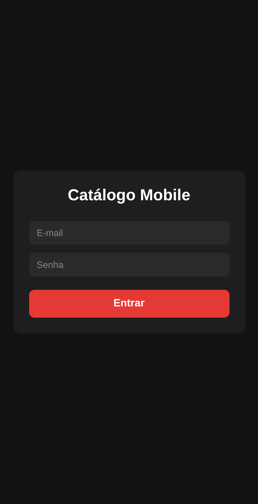
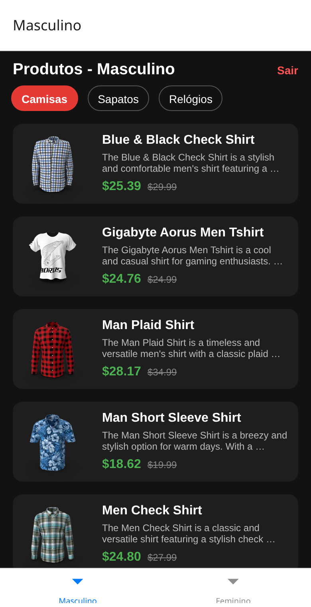
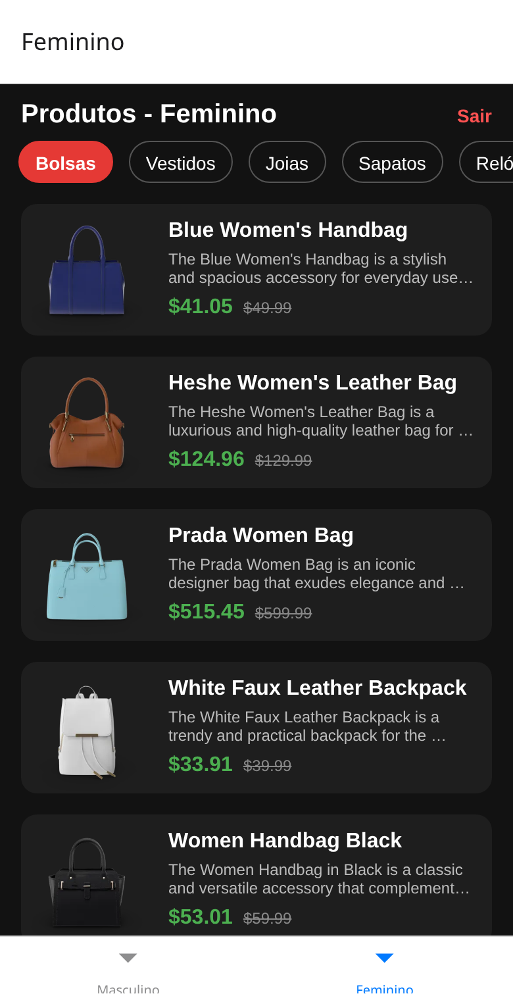
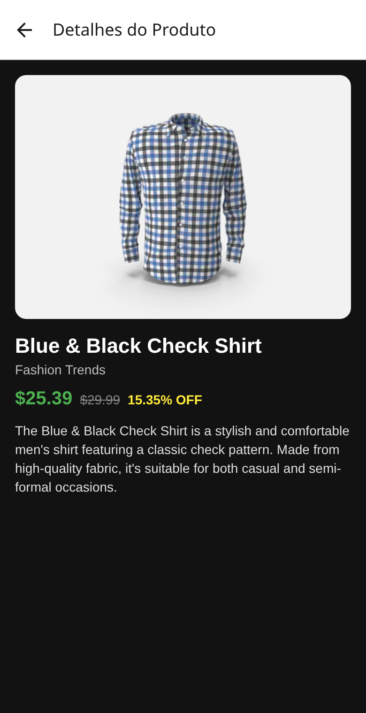

# Catálogo Interativo Mobile

Aplicativo de catálogo de moda desenvolvido por **Diogo Fuentes Pereira** para a disciplina **Mobile Development**. O fluxo começa com um login simulado e segue para as abas Masculino e Feminino. Cada cartão abre a tela do produto correspondente.

## Executar o projeto

Pré-requisitos: Node.js 20.19.4 ou superior, npm e acesso à internet. Para rodar no celular, use o Expo Go compatível com o SDK 54. Também é possível usar um emulador compatível ou o navegador.

```bash
git clone https://github.com/cavani530/mobile-catalogo.git
cd mobile-catalogo
npm ci
npx expo start
```

No terminal do Expo, leia o QR code com o dispositivo ou pressione `a` para Android, `i` para o simulador iOS no macOS ou `w` para a versão web. Use um e-mail com formato válido e uma senha fictícia preenchida, por exemplo `demo@exemplo.com` e `123456`.

## Fluxo e comportamento

- **Login** — Valida o formato do e-mail e exige uma senha preenchida. O Redux Toolkit guarda o e-mail da sessão em memória. A senha fica somente no formulário.
- **Catálogo** — As abas Masculino e Feminino agrupam as oito categorias. Os filtros consultam somente a categoria selecionada. A tela apresenta carregamento, lista vazia e erro com opção de tentar novamente.
- **Detalhes** — A navegação envia o ID do produto para uma segunda consulta. A tela exibe imagem, nome, descrição, preço e percentual de desconto quando disponível. Os valores mantêm a moeda da API (USD).
- **Logout** — O botão **Sair** limpa a sessão no Redux e retorna ao formulário de login.

## API DummyJSON

| Consulta | Endpoint |
|---|---|
| Listar produtos | `GET /products/category/{categoria}` |
| Carregar detalhes | `GET /products/{id}` |

- **Masculino** — `mens-shirts`, `mens-shoes`, `mens-watches`.
- **Feminino** — `womens-bags`, `womens-dresses`, `womens-jewellery`, `womens-shoes`, `womens-watches`.

## Tecnologias e estrutura

React Native, Expo SDK 54, JavaScript, Axios, Redux Toolkit com React Redux e React Navigation para pilha e abas.

| Caminho | Responsabilidade |
|---|---|
| `App.js` | Configuração da navegação e acesso ao fluxo autenticado |
| `src/screens/` | Telas de login, listagem e detalhes |
| `src/components/` | Cartão de produto reutilizável |
| `src/hooks/` | Requisições, carregamento, erro, cancelamento e nova tentativa |
| `src/services/` | Configuração do cliente Axios |
| `src/store/` | Estado temporário da sessão |

## Telas

| Login | Masculino | Feminino | Detalhes |
|---|---|---|---|
|  |  |  |  |

As capturas foram feitas na versão web do Expo, em viewport de celular. O [anexo de funcionalidades](docs/Anexo-Telas-Catalogo-Mobile.pdf) explica o fluxo e inclui as telas de tratamento de erro e saída.

## Referências

- [Documentação do Expo](https://docs.expo.dev/)
- [Documentação da API de produtos DummyJSON](https://dummyjson.com/docs/products)
- [Documentação do Axios](https://axios-http.com/)
- [Documentação do Redux Toolkit](https://redux-toolkit.js.org/)

## Vídeo pitch

[Baixar a demonstração em MP4](docs/Pitch-Catalogo-Mobile.mp4). O vídeo mostra login, abas, detalhes, tratamento de erro e saída, com narração de Diogo Fuentes Pereira e gravação da versão web do Expo em resolução móvel.
